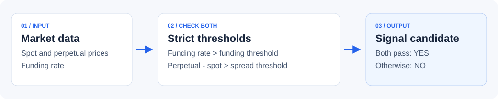

# Crypto Funding Rate Arbitrage

**Explore spot–perpetual funding signals in Python, starting with an offline demo.**

[](https://github.com/R1cK-ChaN/crypto-funding-arbitrage/actions/workflows/tests.yml)
[](https://www.python.org/downloads/)

A small, readable research prototype for studying the relationship between spot
prices, perpetual prices, and funding rates. The offline demo runs the same signal
detector as the OKX monitor using clearly labeled synthetic data.

**Start without API keys, installed packages, or an exchange account.**

[Run the demo](#quick-start) · [Understand the signal](#how-the-signal-works) ·
[Implementation status](#implementation-status) · [Contribute](CONTRIBUTING.md)

## Quick start

With Python 3.10 or later:

```bash
git clone https://github.com/R1cK-ChaN/crypto-funding-arbitrage.git
cd crypto-funding-arbitrage
python3 examples/demo.py
```

On Windows, use `py -3` instead of `python3`.

The demo runs once, prints the following report, and exits. It makes no network
requests and never enters the order-execution path.

```text
OFFLINE DEMO | synthetic data | no API keys | no orders
Signal: funding > 0.0100% AND swap - spot > 10.00 USDT

Pair     Spot (USDT)   Swap (USDT)     Funding      Spread   Signal
BTC         60000.00      60030.00    0.0200%        30.00      YES
ETH          3000.00       3020.00    0.0050%        20.00       NO
SOL           150.00        155.00    0.0200%         5.00       NO

A signal passes two thresholds; it is not a net-profit estimate.
```

Change the fixtures and thresholds in [examples/demo.py](examples/demo.py) to
explore why BTC passes, ETH fails the funding check, and SOL fails the spread check.
The report is generated from illustrative values, not live quotes or a backtest.

## How the signal works



The current detector requires both conditions to be strictly greater:

```python
funding_rate > funding_threshold
swap_price - spot_price > spread_threshold
```

Funding uses a decimal rate: `0.0001` is `0.01%` for a funding period, not an
annual return. The spread is an **absolute USDT price difference per unit**,
not a percentage. The same absolute threshold has different significance for
BTC and lower-priced assets. Equality does not trigger a signal.

The strategy idea is to pair long spot exposure with short perpetual exposure
when funding is positive. A threshold signal alone does not account for fees,
slippage, basis changes, funding reversals, or liquidation risk.

## Implementation status

| Component | Current behavior |
| --- | --- |
| Offline demo | Runs the existing detector on three synthetic scenarios; no credentials or third-party packages |
| Signal detection | Compares funding and absolute price-spread thresholds |
| OKX adapter | Fetches ticker and funding-rate data through HTTP; currently signs requests |
| Monitor loop | Checks configured pairs sequentially and writes logs |
| Order execution | Placeholder: logs an intended position; does not submit orders |
| Position sizing | Placeholder: returns `max_position_size` unchanged |
| Backtesting and performance | Not implemented; no measured returns are published |
| Demo-trading switch | `is_test` is stored but does not change request routing or headers |

Use the offline demo to evaluate the project first. The execution and sizing
placeholders do not provide a complete trading or risk-management system.

## Explore the existing monitor

The monitor is a separate development path from the offline demo. It requires
the dependencies in [requirements.txt](requirements.txt) and a local configuration:

```bash
python3 -m venv .venv
source .venv/bin/activate
python -m pip install -r requirements.txt
cp config/config.example.yaml config/config.yaml
```

On Windows, activate with `.venv\Scripts\Activate.ps1` and copy the example with
`Copy-Item config/config.example.yaml config/config.yaml` in PowerShell.

The configuration example documents every existing setting. The current HTTP
adapter expects credentials; use a key limited to reading data if you investigate
that path. Keep credentials in the ignored `config/config.yaml` file. Do not paste
them into issues, commits, or screenshots. `is_test: true` does **not** enable an
exchange sandbox in this implementation.

After configuring the adapter, its entry point is `python src/main.py`, run from
the repository root. Stop it with Ctrl+C; logs go to `logs/`. The offline checks
below do not verify live exchange connectivity or account permissions.

| Setting | Meaning |
| --- | --- |
| `trading_pairs` | Base assets such as `BTC`; the monitor appends `-USDT` and `-USDT-SWAP` |
| `funding_threshold` | Decimal rate per funding period; `0.0001` means `0.01%` |
| `spread_threshold` | Absolute difference between perpetual and spot prices, in USDT per unit |
| `check_interval` | Seconds to wait after scanning all pairs |
| `max_position_size` | Value returned unchanged by the placeholder sizing function; not a risk limit |

## Development

The demo and its tests use the Python standard library:

```bash
python3 -S -m unittest discover -s tests -v
python3 -S examples/demo.py
```

`-S` disables loading site packages, so these commands also check that the offline
path does not depend on the exchange client's installed packages. Tests cover
threshold boundaries, missing data, and the demo's network-free behavior.

```text
examples/demo.py                   Synthetic market data and terminal report
config/config.example.yaml        Documented monitor configuration
src/strategies/funding_arbitrage.py Signal detector and monitoring loop
src/exchange/okx_client.py         OKX HTTP adapter
src/utils/                        Logging and placeholder position sizing
tests/test_offline_demo.py         Offline regression tests
```

## Help improve the project

Useful next contributions include a fee-aware signal model, instrument-specific
funding intervals, and better market-data error handling. These are future work,
not current features. See [CONTRIBUTING.md](CONTRIBUTING.md) for setup and verification.

[Report a bug](https://github.com/R1cK-ChaN/crypto-funding-arbitrage/issues/new?template=bug_report.md)
or [suggest an improvement](https://github.com/R1cK-ChaN/crypto-funding-arbitrage/issues/new?template=feature_request.md).
If the demo helps your research, a star makes the project easier to find again.
